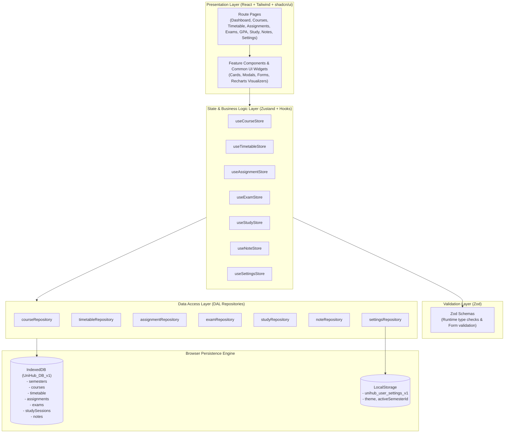
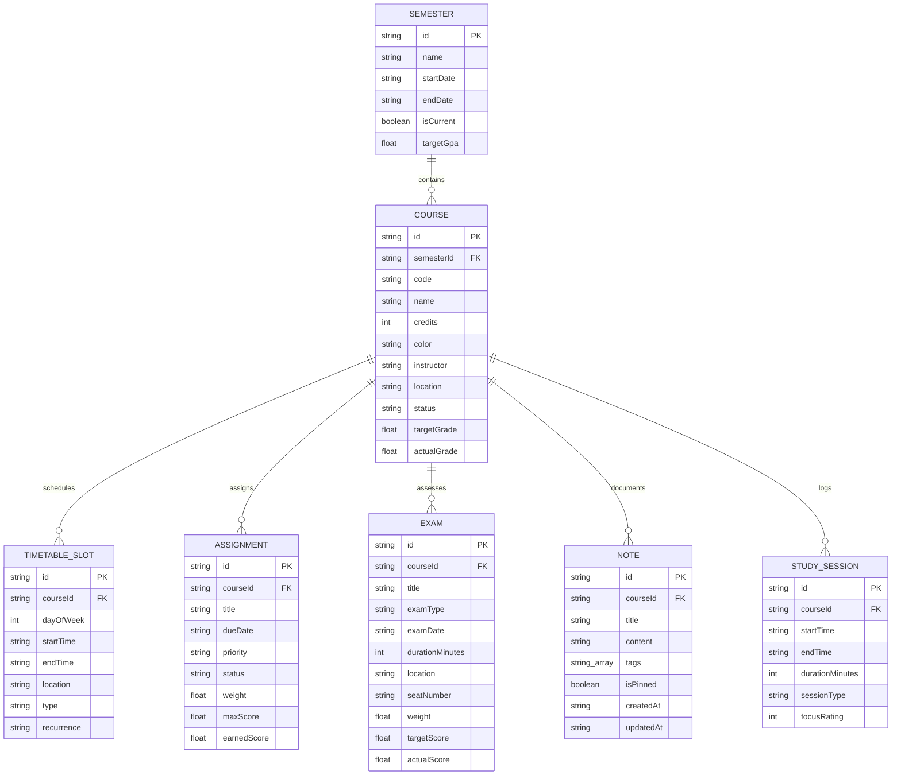
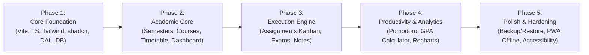

# UniHub Technical Architecture Manual

> **Document Version**: 1.0.0  
> **Target Audience**: Core Maintainers, Solo Fullstack Engineers, AI Coding Agents  
> **Status**: Approved Architectural Baseline  

---

## 1. Executive Summary & Philosophy

**UniHub** is an offline-first, client-side university student productivity workstation. It consolidates academic planning, class scheduling, deadline management, exam countdowns, GPA simulations, focused study tracking, and lecture notes into a single cohesive, high-performance web application.

### Architectural Principles:
1. **Zero External Backend Overhead**: The entire system executes in the browser. Zero AWS bills, zero server maintenance, zero API latency.
2. **Offline-First & Refresh-Resilient**: IndexedDB handles relational entity storage, while LocalStorage retains fast, synchronous user preferences. The application never loses unsaved state on a browser crash or refresh.
3. **Strict Separation of Concerns**:
   - **UI Layer (`@/components`, `@/features`)**: Pure presentation, renders data and dispatches user actions.
   - **Business Logic Layer (`@/stores`, `@/features/*/hooks`)**: State transformations, active filters, clash detection, GPA calculation.
   - **Data Access Layer (`@/lib/storage`)**: Centralized repository abstraction providing typed CRUD operations and schema migrations.
4. **Beginner-Friendly Maintainability**: Avoid complex abstractions. Code is modular, type-safe, and self-documenting.

---

## 2. High-Level System Architecture



---

## 3. Entity-Relationship Overview

The academic domain model centers around the **Semester** and **Course** root entities:



---

## 4. Routing Architecture (React Router v6+)

The application uses a standard nested route layout with an overarching App shell (`Sidebar`, `Navbar`, `Breadcrumbs`, and `Outlet`):

```text
/
├── /dashboard              -> Overview: Today's schedule, 7-day deadlines, quick GPA snapshot, study stats
├── /courses                -> Course catalog, semester tabs, course creation modal
│   └── /courses/:id        -> Course cockpit: Syllabus components, linked tasks, exams, lecture notes
├── /timetable              -> Weekly interactive schedule grid & daily agenda view with clash warnings
├── /assignments            -> Deadline tracker: Kanban view (Todo / In Progress / Submitted / Graded) & Table view
├── /exams                  -> Exam hub: Chronological timeline, countdown widgets, seat info, topic checklists
├── /gpa                    -> GPA calculator: Cumulative vs Semester GPA, grading scale switch, simulator
├── /study                  -> Study tracker: Pomodoro timer, stopwatch, session history, Recharts analytics
├── /notes                  -> Knowledge vault: Markdown split-pane editor, tag-based filtering, course linking
└── /settings               -> Configuration: Semester manager, theme, Pomodoro preferences, Backup JSON Export/Import
```

---

## 5. Global State Management (Zustand Strategy)

To ensure high performance and prevent unnecessary re-renders, state is partitioned into domain-scoped stores rather than one massive monolith:

| Store Name | Primary Responsibility | Sync Mechanism |
| :--- | :--- | :--- |
| `useCourseStore` | Courses, active course filter, syllabus weights | Optimistic UI + `courseRepository` |
| `useTimetableStore` | Weekly schedule slots, schedule collision checks | Optimistic UI + `timetableRepository` |
| `useAssignmentStore` | Assignments, status updates, priority filters | Optimistic UI + `assignmentRepository` |
| `useExamStore` | Exams, upcoming countdown triggers | Optimistic UI + `examRepository` |
| `useStudyStore` | Active timer ticker (Pomodoro/Stopwatch), history | Optimistic UI + `studyRepository` |
| `useNoteStore` | Notes, active search query, tag filtering | Optimistic UI + `noteRepository` |
| `useSettingsStore` | Active semester, theme, timer durations | Direct LocalStorage sync via `settingsRepository` |

### Standard Store Action Pattern:
```typescript
createAssignment: async (item: Assignment) => {
  // 1. Validate with Zod
  AssignmentSchema.parse(item);

  // 2. Optimistic update (instant UI response)
  set((state) => ({ assignments: [...state.assignments, item] }));

  // 3. Persistent write
  try {
    await assignmentRepository.create(item);
  } catch (error) {
    // 4. Rollback on failure
    set((state) => ({
      assignments: state.assignments.filter((a) => a.id !== item.id),
      error: 'Failed to save assignment locally',
    }));
  }
};
```

---

## 6. Persistence & Data Access Layer (DAL)

### IndexedDB Engine (`@/lib/storage/db.ts`)
- Zero external dependencies. Uses browser standard `window.indexedDB`.
- Database name: `UniHub_DB`, Version: `1`.
- Built-in secondary indexes on `semesterId`, `courseId`, `dueDate`, `examDate`, `dayOfWeek`, and `status` to allow instantaneous indexed range queries without scanning all records.

### LocalStorage Engine (`@/lib/storage/dal.ts`)
- Key: `unihub_user_settings_v1`.
- Fast, synchronous access for critical app initialization parameters: `theme` (avoids dark mode flash), `activeSemesterId`, and Pomodoro clock configurations.

### Import / Export & Disaster Recovery
- Full database serialization into a single JSON envelope (`UniHubBackupData`).
- Inbound JSON is strictly validated using `UniHubBackupDataSchema.safeParse()`. Corrupted or tampered files are rejected before touching IndexedDB.

---

## 7. Implementation Roadmap



- **Phase 1: Foundation (Current)**
  - Repository structure, TypeScript interfaces, Zod schemas, IndexedDB DAL, seed data, and agent rules.
- **Phase 2: Academic Core**
  - App shell (Sidebar, Navbar, Theme toggler), Semester selector, Course manager, Weekly timetable grid with clash detection, and Dashboard summary widgets.
- **Phase 3: Task & Knowledge Engine**
  - Assignment Kanban board, Exam countdown cards, Markdown notes editor with tag filtering.
- **Phase 4: Analytics & Study Tools**
  - Pomodoro timer widget with audio cues, Recharts study time analytics, GPA & target grade simulator.
- **Phase 5: Production Readiness**
  - Backup export/import wizard, full demo data reset, PWA manifest for offline desktop/mobile installation.

---

## 8. Technical Decisions & Risk Matrix

| Risk / Challenge | Architectural Decision | Rationale |
| :--- | :--- | :--- |
| **Data Loss on Clear Cache** | JSON Backup / Restore + Clear Warning Banners | Browsers may clear IndexedDB on rare storage pressure. One-click JSON backup lets students save backups to Google Drive or local disk. |
| **State Desynchronization** | Feature-scoped Zustand stores + Optimistic updates | Isolates re-renders to only the active feature. Bypasses bulky context providers. |
| **Timezone & Date Bugs** | Standardized UTC ISO-8601 strings + `date-fns` | Prevents dreaded midnight date shifts across international timezones. |
| **Class Schedule Overlaps** | Pure algorithmic clash detection in `timetableRepository` | Warns students immediately during course enrollment if two lectures share the same time slot. |
| **Overengineering Trap** | Native IndexedDB wrapper instead of heavy ORMs | Eliminates version mismatch bugs and reduces bundle size by >120kB. |
